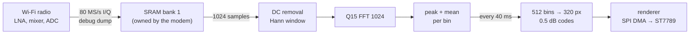

# t-sdr-c5

**A pocket Wi-Fi spectrum waterfall for the LilyGO T-Display-C5.**

The ESP32-C5 has a dual-band (2.4 + 5 GHz) Wi-Fi radio. ESP-SDR found an
undocumented debug path that delivers its raw I/Q samples to the CPU.
t-sdr-c5 runs FFTs on the chip itself and draws a live spectrum and waterfall
anywhere from 2130 to 2730 MHz and from 4790 to 5990 MHz on the board's 1.9" screen:
Wi-Fi, the 13 cm amateur band, 5.8 GHz FPV video and more. It needs no PC,
no SDR dongle and no extra hardware: just the board and its antenna.

[](https://github.com/KamranAghlami/t-sdr-c5/actions/workflows/ci.yml)
[](https://github.com/KamranAghlami/t-sdr-c5/releases)
[](LICENSE)
[](https://kamranaghlami.github.io/t-sdr-c5/)

> **Status:** [v0.2.0](https://github.com/KamranAghlami/t-sdr-c5/releases/latest) is the full channel
> view (fast capture, upper-5 GHz tuning, auto-level gain, settings menu, battery), verified on
> hardware. `main` adds the band survey and tuning by frequency. Flash it [from the browser](https://kamranaghlami.github.io/t-sdr-c5/). A band-survey view is
> next; see [the milestones](docs/SPEC.md#9-milestones).

## Features

- Live **spectrum + waterfall** around any frequency, about 25 lines per second.
- Two ranges, **2130–2730 MHz** and **4790–5990 MHz** (the chip's measured exact-tuning limits),
  tuned in 1 / 5 / 10 / 20 MHz steps with the two buttons.
- **Band survey:** a whole range in one waterfall, swept in 40 MHz steps with the receiver's passband
  shape learned and removed, so the floor stays flat.
- 80 MS/s capture with a 1024-point FFT (78 kHz bins). Selectable 20 / 40 / 80 MHz span,
  so you can see neighbouring Wi-Fi channels overlap.
- Peak-hold detector by default (the right choice for bursty Wi-Fi), with a mean detector and a decaying
  peak trace on the spectrum.
- Automatic noise-floor tracking with a 40 dB display range, and turbo or grey colour maps.
- **Auto-level gain:** a fixed gain just below clipping, so the waterfall doesn't pump the way the
  chip's hardware AGC does on every packet. Hardware AGC or a manual gain are also available.
- Settings menu (span, detector, gain, colours, brightness, version), battery percentage.
- Remembers the range, the frequency per range and all settings across power cycles.

Want the board as a USB SDR for a PC instead? Flash [ESP-SDR](https://github.com/ESPARGOS/esp-sdr)
itself and use its browser viewer. t-sdr-c5 is the standalone counterpart.
- **Receive-only.** The firmware never transmits on purpose (see [Limitations](#limitations)).

## Hardware

| | |
|---|---|
| Board | [LilyGO T-Display-C5](https://github.com/Xinyuan-LilyGO/T-Display-C5) (ESP32-C5-WROOM-1U-N16R8, 16 MB flash, 8 MB PSRAM) |
| Display | 1.9" 170×320 ST7789 IPS, used in landscape |
| Antenna | Dual-band 2.4/5 GHz on the IPEX connector (ships with the board). **Connect it.** |
| Power | USB-C or a 1S LiPo on the JST connector |

The touch variant works too; touch is not used.

## Flashing

**Easiest: [flash it from your browser](https://kamranaghlami.github.io/t-sdr-c5/)** in Chrome, Edge
or Opera on a desktop. Plug the board in, pick a version (the latest is preselected), click
*Install* and pick its serial port. Updating this way keeps your settings.

Without Web Serial, use esptool and the release image:

1. Download `t-sdr-c5-<version>-merged.bin` from the
   [latest release](https://github.com/KamranAghlami/t-sdr-c5/releases/latest).
2. Flash it at offset **`0x0`**:
   ```sh
   pipx run esptool --chip esp32c5 -p /dev/ttyACM0 write-flash 0x0 t-sdr-c5-<version>-merged.bin
   ```
   The merged image also overwrites the settings area, which suits a fresh install. To update and keep
   your settings, flash the separate images from the release archive instead:
   `write-flash 0x2000 bootloader.bin 0x8000 partition-table.bin 0x10000 t_sdr_c5.bin`
   (offsets are in `flash_args` / `offsets.json`).
3. If the board doesn't enter download mode, hold **BOOT**, tap **RST**, then release **BOOT**.

## Using it

Button **A** is the one labelled `USER` (IO0); button **B** is `BOOT` (IO28):

| Press | Action |
|---|---|
| **A** short | tune down by the step (wraps at the range edge); in the band view, move the cursor |
| **B** short | tune up by the step; in the band view, move the cursor |
| **A** long (0.7 s) | switch range 2.4 ↔ 5 GHz; each range remembers its frequency |
| **B** long (0.7 s) | open the settings menu |
| **A + B** | freeze / unfreeze the picture |

In the menu, **B** moves to the next item (the same button that opened it), **A** changes the
value, and a long press on either (or A + B) closes the menu. Changes apply at once and are saved
automatically.

| Item | Values |
|---|---|
| View | Detail (around the tuned frequency) / Band (the whole range) |
| Span | 20 / 40 / 80 MHz |
| Step | 1 / 5 (default) / 10 / 20 MHz per press |
| Detector | Peak (default) / Mean |
| Gain | Auto (auto-level) / HW AGC / manual 8, 16, … |
| Colours | Turbo / Grey |
| Bright | 20 … 100 % |
| Version | firmware version |

### Settings explained

Each waterfall line is built from around 30 short snapshots of the radio (12.8 µs each) taken
during its 40 ms. Most settings change how those snapshots turn into pixels.

**View: Detail / Band.** *Detail* shows the span around the tuned frequency. *Band*
sweeps the whole range in 40 MHz steps and stitches them into one line: 15 steps for 2130–2730 MHz,
30 for 4790–5990 MHz (about 1 ms per retune, so roughly 15–25 lines/s). The bar on the band view's
axis marks what the detail view would show; switch back to *Detail* to look there closely.
Every 40 MHz capture passes noise more strongly at its centre than at its edges. The band view
learns that shape from the quietest steps and divides it out, so for about a second after
switching ranges the floor can look uneven.

**Span: 20 / 40 / 80 MHz.** How much spectrum the 320-pixel width covers, centred on the tuned
frequency.
- **20 MHz** is exactly one Wi-Fi channel's width, at the finest detail (62.5 kHz per pixel).
- **40 MHz** (default) adds 10 MHz on each side. In 2.4 GHz Wi-Fi, where channels
  overlap, you see the neighbours bleeding in.
- **80 MHz** shows everything the radio captures. Beyond about ±24 MHz the radio's own analog filter
  rolls off, so signals near the edges look weaker than they are.

**Detector: Peak / Mean.** How the snapshots of one line are combined for each pixel.
- **Peak** (default) keeps the strongest value seen in any snapshot. Wi-Fi is bursty (packets last
  microseconds to a few milliseconds), so a packet caught by even one snapshot shows up. That is
  why Peak suits Wi-Fi. The cost is a grainier, slightly higher-looking noise floor.
- **Mean** averages the snapshots. The noise floor gets smooth and steady signals stand out, but a
  brief packet seen by one snapshot out of 30 nearly disappears. Use it to judge continuous signals
  or the background noise.
- The spectrum plot above the waterfall always shows both: the cyan trace is the mean, the yellow
  dots a slowly decaying peak hold. The detector only affects the waterfall.

**Step: 1 / 5 / 10 / 20 MHz.** How far one short press of A or B tunes (or moves the band view's
cursor). 5 MHz is the Wi-Fi channel raster in 2.4 GHz; 20 MHz moves a whole 5 GHz channel.

**Gain: Auto / HW AGC / manual.** How much the receiver amplifies before its 10-bit ADC. Too much
and strong signals clip (the waterfall smears, false signals appear); too little and weak signals
sink into the noise. The number is the chip's gain-table index, not dB; higher means more gain.
The status bar shows the mode letter and the index in use, for example `A26`.
- **Auto** (`A`, default) holds one fixed gain and adjusts it only between lines. When a line clips,
  the gain drops by 4 right away. After 2 s with nothing above a quarter of full scale, it rises by 2.
  The picture stays steady and settles within a second or so of moving near a strong access point.
- **HW AGC** (`H`) hands control to the chip's own Wi-Fi AGC, which changes the gain inside each
  packet, as a Wi-Fi modem needs. Snapshots then get different gains, so levels jump from line to
  line and the waterfall flickers. It's mostly there for comparison.
- **Manual 8, 16, …** (`G`) holds one gain for good. Use it to compare frequencies or places under the
  same receiver conditions, since Auto might pick a different gain at each.

**Colours: Turbo / Grey.** The waterfall palette. Turbo runs blue → green → yellow → red for maximum
contrast; Grey is monochrome. In both, the darkest colour is the noise floor and the brightest is
about 40 dB above it. The floor is tracked automatically, so these are relative levels.

**Bright: 20–100 %.** Backlight level. Lower values save battery.

**Version.** The firmware version. Nothing to change.

```
┌──────────────────────────────────────────────┐
│ 2.4G 2437 MHz                  40MHz PEAK    │  range, tuned frequency | span (BAND), detector
│                            25/s A42 87%      │  lines/s, gain (A=auto H=HW AGC G=manual), power
├──────────────────────────────────────────────┤
│  live spectrum: mean (cyan) + peak hold      │  10 dB grid lines
├──────────────────────────────────────────────┤
│ ▔▔▔▔▔▔ 2430  2440  2450                       │  20 MHz around the centre (band view: the span), MHz
├──────────────────────────────────────────────┤
│  waterfall, newest line at the top           │  ≈4 s of history
└──────────────────────────────────────────────┘
```

Power shows `87%` on battery, `87%+` while charging, and `USB` on external power with the
cell full or absent. The gauge can't tell those two apart: with USB connected and no cell, the
charger holds the battery pin at full voltage.

Colours in the waterfall are relative to the tracked noise floor: dark blue is
the floor, red is about 40 dB above it. The status bar turns orange while the
picture is frozen and red if the radio stops delivering captures.

## How it works



- The radio runs in Wi-Fi NULL/promiscuous mode with the PHY calibrated as usual.
  ESP-SDR's receiver then retunes the PLL to any frequency and triggers the
  hidden ADC dump engine, which writes I/Q words straight into a reserved 128 KiB SRAM bank.
- Each capture is 12.8 µs of RF (1024 samples at 80 MS/s). As many captures as fit go into
  each 40 ms waterfall line, combined as peak and mean power per FFT bin.
- A UI task streams the frame to the panel in 16-row DMA bands. While it waits for SPI,
  the radio task keeps capturing.
- Static RAM is the tight resource: everything has to fit below the dump bank, so large
  buffers live on the heap or in PSRAM. Details are in [the spec](docs/SPEC.md).

## Limitations

- **It samples; it isn't gapless.** Each 40 ms line looks at well under 1 ms of RF.
  Busy Wi-Fi channels and beacons show up clearly, but a single short burst can be missed.
- Levels are uncalibrated dB. Expect a small residual spike at the centre (zero-IF DC/LO
  leakage, mostly removed) and faint mirror images of very strong signals.
- The passband is flat to about ±20 MHz. In the 80 MHz span, the edges are attenuated.
- 5 GHz uses the Wi-Fi driver's PLL path (as measured by ESPsoup) to stay sensitive above
  5745 MHz. Individual boards can still have dead spots.
- No reception below about 2.1 GHz on this chip; the ranges stop at the measured exact-tuning limits
  (ESPsoup's boards). Individual boards can differ near the ends.
- Receive-only, but not RF-silent: the stock PHY start-up and background calibration
  can emit short internal calibration signals, as on any ESP32 Wi-Fi firmware.

## Building

Every build runs in GitHub Actions: host unit tests, the firmware build, an
SRAM-headroom check, then packaging. Pushing a tag `vX.Y.Z` publishes a release.

To build locally you need the **exact ESP-IDF commit in [`idf-ref`](idf-ref)**. It must match
ESP-SDR's C5 pin, because the receiver depends on private PHY internals of that SDK.

```sh
git clone --recurse-submodules https://github.com/KamranAghlami/t-sdr-c5
git clone https://github.com/espressif/esp-idf ~/esp-idf-c5
git -C ~/esp-idf-c5 checkout "$(cat t-sdr-c5/idf-ref)" && git -C ~/esp-idf-c5 submodule update --init --recursive
~/esp-idf-c5/install.sh esp32c5 && . ~/esp-idf-c5/export.sh
cd t-sdr-c5 && idf.py build flash monitor
```

Host tests (no ESP-IDF needed):

```sh
cmake -S tests/host -B build-host && cmake --build build-host && ctest --test-dir build-host
```

Layout: `components/c5_radio` (C, the ESP-SDR-derived receive path), `components/core`
(pure C++ DSP and logic), `components/board` (LCD, buttons), `components/ui` (renderer),
`main` (control loop). Project notes are in [`docs/`](docs).

## Credits

- [ESPARGOS/esp-sdr](https://github.com/ESPARGOS/esp-sdr) by Florian Euchner, Zoltan Doczi
  and contributors: the raw I/Q capture method and the ESP32-C5 receiver this project builds on.
- [pit711/espsoup-firmware](https://github.com/pit711/espsoup-firmware): C5 measurements behind
  the fast capture engine, the 5 GHz tuning path and the tuning limits.
- [z1000biker/esp32c3rxtx](https://github.com/z1000biker/esp32c3rxtx), [cyber-murmel/esp-sdr-zephyr](https://github.com/cyber-murmel/esp-sdr-zephyr),
  [Twotoz/C5VRX](https://github.com/Twotoz/C5VRX): ideas and hardware findings.
- [LilyGO](https://github.com/Xinyuan-LilyGO/T-Display-C5) for the board and its pin map.

## License

GPL-3.0-or-later; see [LICENSE](LICENSE) and [NOTICE](NOTICE). The firmware includes
GPL-3.0-or-later code from ESP-SDR. Distributing modified binaries requires offering
the corresponding source.
