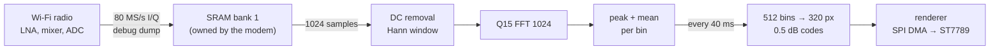

# t-sdr-c5

**A pocket Wi-Fi spectrum waterfall for the LilyGO T-Display-C5.**

The ESP32-C5 has a dual-band (2.4 + 5 GHz) Wi-Fi radio. ESP-SDR found an
undocumented debug path that delivers its raw I/Q samples to the CPU.
t-sdr-c5 runs FFTs on the chip itself and draws a live spectrum and waterfall
of any 2.4 or 5 GHz Wi-Fi channel on the board's 1.9" screen. It needs no PC,
no SDR dongle and no extra hardware: just the board and its antenna.

[](https://github.com/KamranAghlami/t-sdr-c5/actions/workflows/ci.yml)
[](https://github.com/KamranAghlami/t-sdr-c5/releases)
[](LICENSE)

> **Status:** [v0.1.0](https://github.com/KamranAghlami/t-sdr-c5/releases/tag/v0.1.0) is the
> hardware-verified channel view. `main` adds the M3 features (fast capture, upper-5 GHz tuning,
> auto-level gain, settings menu, battery), which are still awaiting their hardware test.
> See [the milestones](docs/SPEC.md#9-milestones).

## Features

- Live **spectrum + waterfall** of the selected Wi-Fi channel, about 25 lines per second.
- **2.4 GHz** channels 1–14 and **5 GHz** channels 36–177, switched with the two buttons.
- 80 MS/s capture with a 1024-point FFT (78 kHz bins). Selectable 20 / 40 / 80 MHz span,
  so you can see the overlapping 2.4 GHz neighbours.
- Peak-hold detector by default (the right choice for bursty Wi-Fi), with a mean detector and a decaying
  peak trace on the spectrum.
- Automatic noise-floor tracking with a 40 dB display range, and turbo or grey colour maps.
- **Auto-level gain:** a fixed gain just below clipping, so the waterfall doesn't pump the way the
  chip's hardware AGC does on every packet. Hardware AGC or a manual gain are also available.
- Settings menu (span, detector, gain, colours, brightness, version), battery percentage.
- Remembers band, channel per band and all settings across power cycles.

Want the board as a USB SDR for a PC instead? Flash [ESP-SDR](https://github.com/ESPARGOS/esp-sdr)
itself and use its browser viewer. t-sdr-c5 is the standalone counterpart.
- **Receive-only.** The firmware never transmits on purpose (see [Limitations](#limitations)).

## Hardware

| | |
|---|---|
| Board | [LilyGO T-Display-C5](https://github.com/Xinyuan-LilyGO/T-Display-C5) (ESP32-C5-WROOM-1U-N16R8, 16 MB flash, 8 MB PSRAM) |
| Display | 1.9" 170×320 ST7789 IPS, used in landscape |
| Antenna | Dual-band 2.4/5 GHz on the IPEX connector (ships with the board). **Connect it.** |
| Power | USB-C or a 1S LiPo on the JST connector |

The touch variant works too; touch is not used.

## Flashing

1. Download `t-sdr-c5-<version>-merged.bin` from the
   [latest release](https://github.com/KamranAghlami/t-sdr-c5/releases)
   (or the `firmware` artifact of any [CI run](https://github.com/KamranAghlami/t-sdr-c5/actions)).
2. Flash it at offset **`0x0`**:
   - **Browser:** open [esptool-js](https://espressif.github.io/esptool-js/) in Chrome or Edge,
     connect, add the file at `0x0` and program it.
   - **Command line:**
     ```sh
     pipx run esptool --chip esp32c5 -p /dev/ttyACM0 write-flash 0x0 t-sdr-c5-<version>-merged.bin
     ```
3. If the board doesn't enter download mode, hold **BOOT**, tap **RST**, then release **BOOT**.

The release archive also contains the separate bootloader, partition table and app images
with `flash_args` / `offsets.json`, if you would rather flash them individually.

## Using it

Button **A** is the one labelled `USER` (IO0); button **B** is `BOOT` (IO28):

| Press | Action |
|---|---|
| **A** short | previous channel (wraps around) |
| **B** short | next channel (wraps around) |
| **A** long (0.7 s) | switch band 2.4 ↔ 5 GHz; each band remembers its channel |
| **B** long (0.7 s) | open the settings menu |
| **A + B** | freeze / unfreeze the picture |

In the menu, **A** moves to the next item, **B** changes its value, and a long press on either
(or A + B) closes the menu. Changes are saved automatically.

| Item | Values |
|---|---|
| Span | 20 / 40 / 80 MHz |
| Detector | Peak (default) / Mean |
| Gain | Auto (auto-level) / HW AGC / manual 8, 16, … |
| Colours | Turbo / Grey |
| Bright | 20 … 100 % |
| About | firmware version |

```
┌──────────────────────────────────────────────┐
│ 2.4G CH6 2437                  40MHz PEAK    │  band, channel, centre MHz | span, detector
│                            25/s A42 87%      │  lines/s, gain (A=auto H=HW AGC G=manual), power
├──────────────────────────────────────────────┤
│  live spectrum: mean (cyan) + peak hold      │  10 dB grid lines
├──────────────────────────────────────────────┤
│ ▔▔▔▔▔▔ 2430  2440  2450                       │  selected 20 MHz channel, MHz labels
├──────────────────────────────────────────────┤
│  waterfall, newest line at the top           │  ≈4 s of history
└──────────────────────────────────────────────┘
```

Power shows `87%` on battery, `87%+` while charging, and `USB` on external power with the
cell full or absent. The gauge can't tell those two apart: with USB connected and no cell, the
charger holds the battery pin at full voltage.

Colours in the waterfall are relative to the tracked noise floor: dark blue is
the floor, red is about 40 dB above it. The status bar turns orange while the
picture is frozen and red if the radio stops delivering captures.

## How it works



- The radio runs in Wi-Fi NULL/promiscuous mode with the PHY calibrated as usual.
  ESP-SDR's receiver then retunes the PLL to any frequency and triggers the
  hidden ADC dump engine, which writes I/Q words straight into a reserved 128 KiB SRAM bank.
- Each capture is 12.8 µs of RF (1024 samples at 80 MS/s). As many captures as fit go into
  each 40 ms waterfall line, combined as peak and mean power per FFT bin.
- A UI task streams the frame to the panel in 16-row DMA bands. While it waits for SPI,
  the radio task keeps capturing.
- Static RAM is the tight resource: everything has to fit below the dump bank, so large
  buffers live on the heap or in PSRAM. Details are in [the spec](docs/SPEC.md).

## Limitations

- **It samples; it isn't gapless.** Each 40 ms line looks at well under 1 ms of RF.
  Busy channels and beacons show up clearly, but a single short burst can be missed.
- Levels are uncalibrated dB. Expect a small residual spike at the centre (zero-IF DC/LO
  leakage, mostly removed) and faint mirror images of very strong signals.
- The passband is flat to about ±20 MHz. In the 80 MHz span, the edges are attenuated.
- 5 GHz uses the Wi-Fi driver's PLL path (as measured by ESPsoup) to stay sensitive above
  5745 MHz. Individual boards can still have dead spots.
- No reception below about 2.1 GHz on this chip.
- Receive-only, but not RF-silent: the stock PHY start-up and background calibration
  can emit short internal calibration signals, as on any ESP32 Wi-Fi firmware.

## Building

Every build runs in GitHub Actions: host unit tests, the firmware build, an
SRAM-headroom check, then packaging. Pushing a tag `vX.Y.Z` publishes a release.

To build locally you need the **exact ESP-IDF commit in [`idf-ref`](idf-ref)**. It must match
ESP-SDR's C5 pin, because the receiver depends on private PHY internals of that SDK.

```sh
git clone --recurse-submodules https://github.com/KamranAghlami/t-sdr-c5
git clone https://github.com/espressif/esp-idf ~/esp-idf-c5
git -C ~/esp-idf-c5 checkout "$(cat t-sdr-c5/idf-ref)" && git -C ~/esp-idf-c5 submodule update --init --recursive
~/esp-idf-c5/install.sh esp32c5 && . ~/esp-idf-c5/export.sh
cd t-sdr-c5 && idf.py build flash monitor
```

Host tests (no ESP-IDF needed):

```sh
cmake -S tests/host -B build-host && cmake --build build-host && ctest --test-dir build-host
```

Layout: `components/c5_radio` (C, the ESP-SDR-derived receive path), `components/core`
(pure C++ DSP and logic), `components/board` (LCD, buttons), `components/ui` (renderer),
`main` (control loop). Project notes are in [`docs/`](docs).

## Credits

- [ESPARGOS/esp-sdr](https://github.com/ESPARGOS/esp-sdr) by Florian Euchner, Zoltan Doczi
  and contributors: the raw I/Q capture method and the ESP32-C5 receiver this project builds on.
- [pit711/espsoup-firmware](https://github.com/pit711/espsoup-firmware): C5 measurements behind
  the upcoming fast capture engine and 5 GHz tuning path.
- [z1000biker/esp32c3rxtx](https://github.com/z1000biker/esp32c3rxtx), [cyber-murmel/esp-sdr-zephyr](https://github.com/cyber-murmel/esp-sdr-zephyr),
  [Twotoz/C5VRX](https://github.com/Twotoz/C5VRX): ideas and hardware findings.
- [LilyGO](https://github.com/Xinyuan-LilyGO/T-Display-C5) for the board and its pin map.

## License

GPL-3.0-or-later; see [LICENSE](LICENSE) and [NOTICE](NOTICE). The firmware includes
GPL-3.0-or-later code from ESP-SDR. Distributing modified binaries requires offering
the corresponding source.
